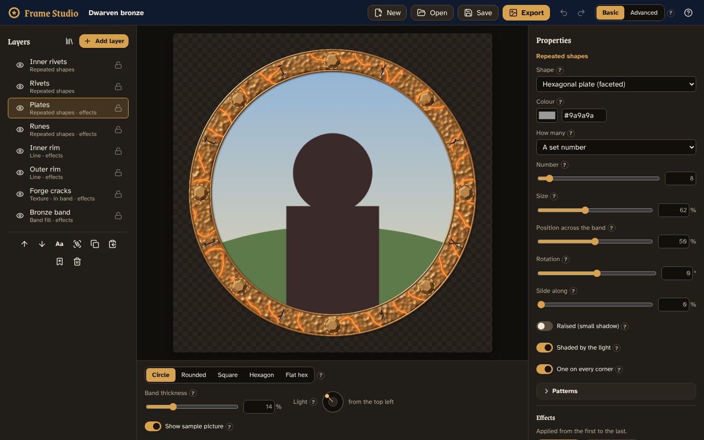
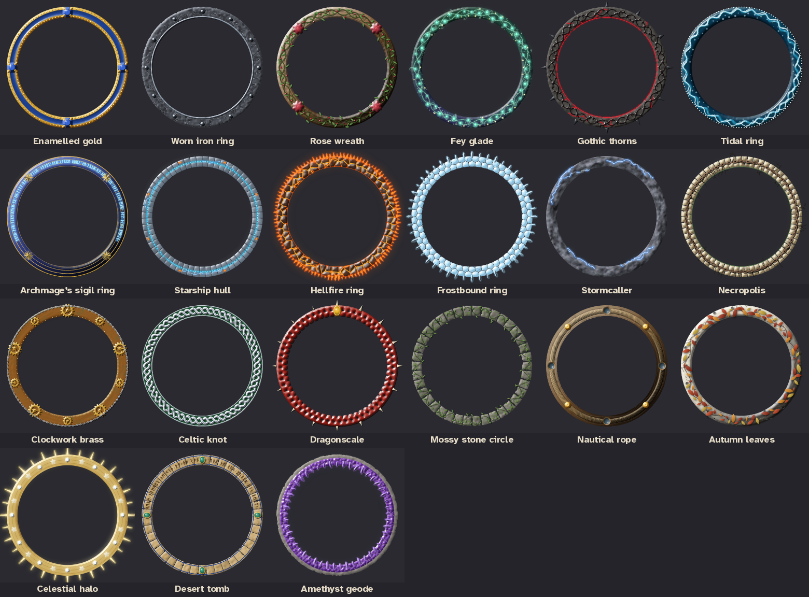
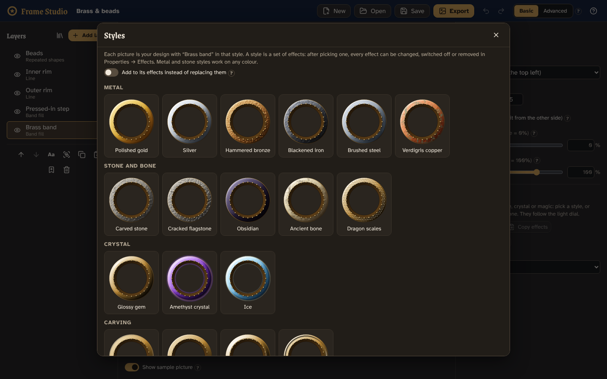

# Frame Studio

A visual editor for code-drawn token frames. Start from one of [Token Maker](https://github.com/GroudonMcL/token-maker)'s 27 frames or from scratch, build a design from layers (bands of colour, lines, rings of beads, runes, gems, shapes and paths you draw yourself…), and save it or export it as a picture. No coding needed; technical settings live in **Advanced**.



## Themed borders

New → **Themed borders** offers 21 ready-made borders in the styles people buy and make for tabletop tokens, every part editable: Enamelled gold, Worn iron ring, Rose wreath, Fey glade, Gothic thorns, Tidal ring, Archmage's sigil ring, Starship hull, Hellfire ring, Frostbound ring, Stormcaller, Necropolis, Clockwork brass, Celtic knot, Dragonscale, Mossy stone circle, Nautical rope, Autumn leaves, Celestial halo, Desert tomb and Amethyst geode. They are made from the same layers, generators, styles and lighting you can use yourself, and fit every token shape.



## What works now (Phase 10)

- **Variations:** the **Variations** button shows six versions of your design (other patterns, colours turned round the colour wheel together, sizes nudged), as different as you like; pick one to use it. Locked layers stay as they are. **Vary the style** in Effects does the same to one layer's effects.
- **Theme:** recolour the whole design from one colour (and an accent colour), keeping how light or dark each part is; Token Maker frames and converted frames recolour too.
- **Your own styles:** **Save as a style** in Effects; they appear first in Styles… and travel in library files.
- **Lighting…** (over the canvas): up to three more coloured lights (a cold rim light, a warm fill), an ambient colour for shaded sides, bloom and light bleeding.
- **Export → Token pack:** one ZIP with the design on every shape at the sizes you choose, see-through and with the sample picture, plus its project file.
- *Not yet:* more token shapes (octagon, triangle, shield) need Token Maker's engine changed first; see [`docs/DESIGN.md`](docs/DESIGN.md) §9.

## Also there from Phase 9

- **Masks:** show a layer only through another layer's shape or brightness, inverted or not (Advanced → Mask).
- **One sculpted surface:** layers in a group can be **raised** out of or **carved** into its surface (Advanced → Shared height); a bevel on the group lights them all as one, so runes cut through a plate slope and catch the light. **Show → Height map / Normal map** (Advanced, under the canvas) shows how it is shaped.
- **Sides** (extrude) and **Grow or shrink** effects; a group can **combine** its shapes (added, cut out, overlapping, all but the overlaps); a path can be drawn as a **tapered stroke**; a shape can be **turned into a path**.
- **Editing:** separate curve handles on a point (or Alt while dragging), drag a group by any of its layers, turn a group round the token, **zoom** (to 800 %) and pan.
- **New template:** Rune-carved plates.

## Also there from Phase 8

- **Generators:** Add layer → **Growth** (vines, roots, thorny stems, curling tendrils, antlers, with leaves, thorns or berries), **Plates and cells** (flagstones, honeycomb, bricks, tiles, scales, with missing pieces), **Cracks and lightning**, **Knotwork** (strands that really weave over and under), **Gears** and **Chain**. Each is made from a few settings and a variation number, runs round the band or along a path, and takes styles and effects like any layer (a bevel on plates bevels each plate).
- **Distortion** effect (wobbly edges, irregular stone) and **scratches** on Wear and grime; wavy lines can **fit their waves to the band**.
- **Four more Token Maker frames convert into editable layers:** Druid, Knotwork, Artificer and Barbarian (22 in all).
- **New template:** Overgrown ruin, made only from generators and styles.

## Also there from Phase 7

- **Ornaments along any path:** Repeated shapes can **follow** a path you drew or a line (wavy or not) instead of the band: facing along it or upright, growing or shrinking along the way, with random variation of size, angle and gaps. The path can be hidden and still be followed.
- **Radial arrays:** repeat a shape or drawn path round a point (how many, how far out, start angle, every other one mirrored), for rosettes, sigils, compass roses and clusters of gems.
- **Gem cuts and settings:** cut gems can be brilliant, rose, emerald, cabochon or rough crystal (facets, table, crown height, sparkle), all lit by the light dial; any repeated shape can sit in a **bezel or four or six claws** in a metal style of its own.
- **Text:** Add layer → Text runs words round the band or along a path, in runes (Elder Futhark, drawn from strokes), Grenze or Atkinson; read the other way for the bottom of a token; give it the Engraved style to cut it in, or a glow.
- **Contours:** several lines round the band at once, tapering, in one or two colours.
- **New template:** Royal inscription.

## Also there from Phase 6

- **Effects on any layer or group** (Properties → Effects): give it depth with **Bevel and surface** (raised or sunk in, rounded, chiselled or stepped edges, and a surface of hammered dents, rough grain, brushed streaks, cracked plates or scales), a **Shadow** or **Glow** (outside or inside its edge), a **Material colour** that turns its shading into gold, silver, bronze, bone, obsidian, jade…, **Colour adjust**, and **Wear and grime** (chipped and rubbed edges, patches of dirt or verdigris). Everything is lit by the light dial, switches off and on, can be reordered, and fits every token shape and thickness.
- **Styles…:** 26 ready-made looks (polished gold, hammered bronze, blackened iron, carved stone, obsidian, amethyst crystal, engraved, arcane glow, hellfire, holy radiance, aged and worn…), each shown as a picture of *your* design in that style. One click applies it to every picked layer; then change any part of it. **Copy effects / Paste effects** moves a look from one layer to others.
- **Facets:** cut a shape or drawn path into flat faces lit by the light (gems, star badges, plates, crystals); repeated shapes can be cut gems, hexagonal plates or crystal shards.
- **More blend modes** (hard light, dodge, burn, darken, lighten, difference, exclusion, hue, saturation, luminosity) and **Cut a hole in the layers below** (in Advanced).
- **New templates made with effects:** Dwarven bronze, Eldritch crystal, Radiant gold and Hellforged iron.
- **The plan these phases followed** is in [`docs/ROADMAP.md`](docs/ROADMAP.md).
- *Token Maker:* designs saved now (format 9) open in Token Maker once its copy of Frame Studio's code is updated with `npm run share:export` (below).



## Also there from Phases 1–5

- **Templates:** all 27 Token Maker frames (each as one layer whose colour you can change), five designs built from editable layers (two with textures), or a blank project.
- **Token Maker frames as editable layers:** 22 of the frames (Polished, Paladin, Gilded, Engraved, Arcane, Infernal, Wizard, Double line, Oak, Cobblestone, Magma, Harlequin, Starfield, Cleric, Fighter, Monk, Rogue, Sorcerer, and since Phase 8 Druid, Knotwork, Artificer, Barbarian) can be opened as a stack of layers you can change one by one: the band, the pressed-in step, the rims, the textures and the ornaments. They look like the originals (tests measure how close each one is) and, unlike the originals, they follow the light dial. Pick one marked **Editable** in New, or select a Token Maker frame layer and press **Turn into editable layers**; the originals are all still there.
- **Layers:** Band fill, Line (plain or wavy), Repeated shapes, Shape (circle, rectangle, polygon, star) and Path (draw your own), plus Token Maker frames as layers. Show/hide, lock, rename, reorder, duplicate, delete.
- **Groups:** Ctrl+click layers and press Group (Ctrl+G). Hide, lock or fade a whole group at once. Layers can also be clipped to the band or to the layer below.
- **Drawing:** Add layer → Path, then click points on the canvas; click the first point (or press Enter) to finish. Drag points and their round handles; double-click a point to make it curved.
- **Moving things:** drag shapes and paths on the canvas; use the square handle to resize and the round one to turn. Mirror a shape to get a matching pair on the other side.
- **Patterns:** alternate colours and sizes round a ring, leave gaps beside bigger beads, put leaves on alternate sides, draw only every other one (or any on/off pattern), shaded or in one flat colour; shapes to repeat include chevrons, ticks, gears, eyes, notes and claw marks.
- **Textures:** Add layer → Texture… opens a library of the surfaces Token Maker's frames are made of: marble, hammered metal, hide, battle wear, wood grain, stone blocks, stars, rope, dragon scales and magma cracks. Change their colour, how many marks, their size and strength, which side of the light they keep to, and shuffle for another variation. They are drawn the same way Token Maker draws them (tests check this pixel for pixel).
- **Colours round the ring:** paint a band or line with colours that change as they go round the token (like Stamped's), turning with the light if you want. In Advanced, metal paints can have their own highlight colour, gradient colours can be see-through, and a gradient can turn with the light (like a lit rim).
- **Faster editing:** each layer's picture is kept, so changing one layer only redraws that one.
- **Light:** turn the light dial under the canvas to light your layers from any side (it starts at the top left, like Token Maker).
- **Designs fit every token shape:** everything is placed relative to the frame band, so the same design works on a circle, square or hexagon, thick or thin. A shape can be set to "Place freely" if it should stay put instead.
- **Undo/redo**, **autosave** (your work survives a refresh) and **Save/Open** project files (`.framestudio.json`; files from earlier phases still open and look the same).
- **Your library:** pick a layer or group and press **Add to library** (the bookmark under the layer list) to keep it; add it to any other design from **Add layer → From your library**. Export the library as a file to keep a copy or give it to someone, and import it again.
- **Copy and paste layers** with Ctrl+C / Ctrl+V (or the Copy button and Add layer → Paste layers): within a design, into another design, or into another browser tab.
- **Export:** a see-through PNG at any size (16–4096 px), a sheet showing the design on all five token shapes, or the project file with a small preview picture in it (for Token Maker).
- **Help everywhere:** point at (or tap) the **?** beside any setting for a one-sentence tip. A welcome card greets first-time visitors; the **?** button in the top bar brings it back.
- **Phones and tablets:** on a narrow screen the canvas sits on top and the layers and properties are in a sheet underneath; everything is big enough for a finger, and you can drag shapes with one.
- **Keyboard:** move through the layers with the arrow keys, and move the selected layer on the canvas with the arrow keys once the canvas has focus. Accessibility is checked automatically (axe).
- **Use your designs in Token Maker:** save a design (`.framestudio.json`) and, in Token Maker, choose **Frame & shape → Frame type → Frame Studio → Open a Frame Studio design**. It follows the token's shape, thickness and spacing and looks exactly as it does here. Token Maker uses a copy of Frame Studio's own reader and renderer (`npm run share:export`, below).

See [`docs/PROGRESS.md`](docs/PROGRESS.md) for what's next and the known limitations.

## Installing it on Windows

Frame Studio can be installed like any other Windows program, with a Start menu entry and a desktop shortcut. No Node.js needed.

1. Get **`Frame-Studio-Setup-<version>.exe`**: from the repository's **Releases** page, or from the **Actions** tab → **Windows installer** → the latest run → **Artifacts** (it downloads as a zip; the installer is inside). To make a new one, open **Actions → Windows installer → Run workflow**, or push a tag such as `v0.10.0` to also put it on a release.
2. Run it. Windows may say *"Windows protected your PC"* because the installer isn't signed: press **More info**, then **Run anyway**.
3. Choose where to install (the default needs no administrator rights) and press **Install**.

To remove it, use **Settings → Apps → Installed apps → Frame Studio → Uninstall**.

The installed app is the same editor as `npm run dev`, in its own window. Your work is autosaved inside the app (separately from any browser copy), **Save** and **Export** ask where to put the file, and links open in your normal browser.

To build the installer yourself (with Node.js, below): `npm run installer` makes `release\Frame-Studio-Setup-<version>.exe`, and `npm run desktop` opens the desktop app without installing it. The desktop shell is `desktop\main.cjs`; the installer settings are under `"build"` in `package.json` (the version in the installer's name is `package.json`'s `"version"`).

## Running it on Windows

You need [Node.js](https://nodejs.org/) 22 or newer. In PowerShell:

```powershell
cd path\to\Frame-Studio
npm install          # once, or after pulling changes
npm run dev          # then open http://localhost:5173
```

Press `Ctrl+C` in PowerShell to stop it.

## Testing

```powershell
npm test             # unit and pixel tests
npm run typecheck    # TypeScript checks
npm run lint         # code style
npm run build        # production build into dist\
npx playwright install chromium   # once, before the first e2e run
npm run e2e          # end-to-end tests in a real browser
```

Handy for checking by eye:

```powershell
npm run frame-sheet -- sheet.png circle    # every template on one picture (try hexagon, square…)
npm run effects-sheet -- fx.png 240 circle # every style and effects template on one picture
npm run screenshots                        # with npm run dev running: editor screenshots into docs\screenshots
npm run compare-conversions                # each editable Token Maker frame beside its original, with the differences
npm run look -- look.png royal-inscription # templates on every shape (any template ids)
npm run make-fixtures -- name:template:shape:light:showArt   # fixture files for the current format (before changing it)
```

`npm run e2e` also runs the phone tests (a Pixel 7 with touch).

## Keeping the Token Maker engine in step

The frame-drawing code in `src\engine\legacy\` is copied from Token Maker and must not be edited here. With both repositories side by side:

```powershell
npm run engine:check -- ..\token-maker   # lists files that differ
npm run engine:sync -- ..\token-maker    # copies them and records the commit
npm test
```

## Giving Token Maker the Frame Studio code

Token Maker draws Frame Studio designs with a copy of Frame Studio's reader and renderer, kept in step like the engine (the other way round). With both repositories side by side:

```powershell
npm run share:check -- ..\token-maker    # lists files that differ
npm run share:export -- ..\token-maker   # copies them into token-maker\src\frameStudio and records the commit
```

Then run `npm test` in token-maker.

## Documents

- [`docs/DESIGN.md`](docs/DESIGN.md): the design (source of truth).
- [`docs/TOKEN-MAKER-CONTEXT.md`](docs/TOKEN-MAKER-CONTEXT.md): how Token Maker's frames work, and an inventory of all 27.
- [`docs/BUILD-PROMPTS.md`](docs/BUILD-PROMPTS.md): the prompt for each build phase.
- [`docs/PROGRESS.md`](docs/PROGRESS.md): the phase checklist.
- [`docs/ROADMAP.md`](docs/ROADMAP.md): the plan from the owner's "Expanding Frame Studio" brief (Phases 6–10).
- [`docs/PROJECT-STARTER.md`](docs/PROJECT-STARTER.md): the original brief.
