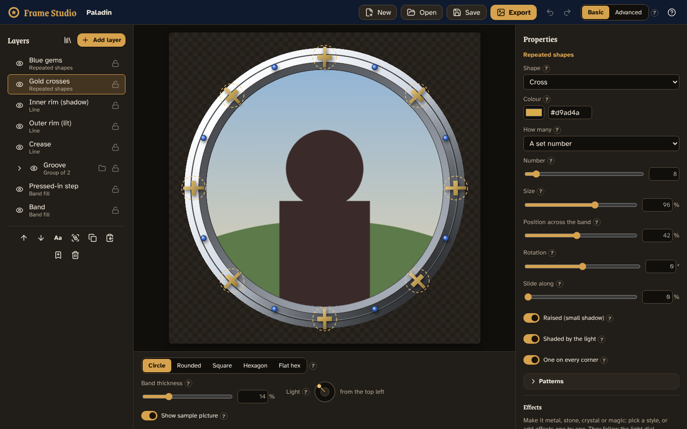

# Frame Studio

A visual editor for code-drawn token frames. Start from one of [Token Maker](https://github.com/GroudonMcL/token-maker)'s 27 frames or from scratch, build a design from layers (bands of colour, lines, rings of beads, runes, gems, shapes and paths you draw yourself…), and save it or export it as a picture. No coding needed; technical settings live in **Advanced**.



## What works now (Phase 5)

- **Templates:** all 27 Token Maker frames (each as one layer whose colour you can change), five designs built from editable layers (two with textures), or a blank project.
- **Token Maker frames as editable layers:** 18 of the frames (Polished, Paladin, Gilded, Engraved, Arcane, Infernal, Wizard, Double line, Oak, Cobblestone, Magma, Harlequin, Starfield, Cleric, Fighter, Monk, Rogue, Sorcerer) can be opened as a stack of layers you can change one by one: the band, the pressed-in step, the rims, the textures and the ornaments. They look like the originals (tests measure how close each one is) and, unlike the originals, they follow the light dial. Pick one marked **Editable** in New, or select a Token Maker frame layer and press **Turn into editable layers**; the originals are all still there.
- **Layers:** Band fill, Line (plain or wavy), Repeated shapes, Shape (circle, rectangle, polygon, star) and Path (draw your own), plus Token Maker frames as layers. Show/hide, lock, rename, reorder, duplicate, delete.
- **Groups:** Ctrl+click layers and press Group (Ctrl+G). Hide, lock or fade a whole group at once. Layers can also be clipped to the band or to the layer below.
- **Drawing:** Add layer → Path, then click points on the canvas; click the first point (or press Enter) to finish. Drag points and their round handles; double-click a point to make it curved.
- **Moving things:** drag shapes and paths on the canvas; use the square handle to resize and the round one to turn. Mirror a shape to get a matching pair on the other side.
- **Patterns:** alternate colours and sizes round a ring, leave gaps beside bigger beads, put leaves on alternate sides, draw only every other one (or any on/off pattern), shaded or in one flat colour; shapes to repeat include chevrons, ticks, gears, eyes, notes and claw marks.
- **Textures:** Add layer → Texture… opens a library of the surfaces Token Maker's frames are made of: marble, hammered metal, hide, battle wear, wood grain, stone blocks, stars, rope, dragon scales and magma cracks. Change their colour, how many marks, their size and strength, which side of the light they keep to, and shuffle for another variation. They are drawn the same way Token Maker draws them (tests check this pixel for pixel).
- **Colours round the ring:** paint a band or line with colours that change as they go round the token (like Stamped's), turning with the light if you want. In Advanced, metal paints can have their own highlight colour, gradient colours can be see-through, and a gradient can turn with the light (like a lit rim).
- **Faster editing:** each layer's picture is kept, so changing one layer only redraws that one.
- **Light:** turn the light dial under the canvas to light your layers from any side (it starts at the top left, like Token Maker).
- **Designs fit every token shape:** everything is placed relative to the frame band, so the same design works on a circle, square or hexagon, thick or thin. A shape can be set to "Place freely" if it should stay put instead.
- **Undo/redo**, **autosave** (your work survives a refresh) and **Save/Open** project files (`.framestudio.json`; files from earlier phases still open and look the same).
- **Your library:** pick a layer or group and press **Add to library** (the bookmark under the layer list) to keep it; add it to any other design from **Add layer → From your library**. Export the library as a file to keep a copy or give it to someone, and import it again.
- **Copy and paste layers** with Ctrl+C / Ctrl+V (or the Copy button and Add layer → Paste layers): within a design, into another design, or into another browser tab.
- **Export:** a see-through PNG at any size (16–4096 px), a sheet showing the design on all five token shapes, or the project file with a small preview picture in it (for Token Maker).
- **Help everywhere:** point at (or tap) the **?** beside any setting for a one-sentence tip. A welcome card greets first-time visitors; the **?** button in the top bar brings it back.
- **Phones and tablets:** on a narrow screen the canvas sits on top and the layers and properties are in a sheet underneath; everything is big enough for a finger, and you can drag shapes with one.
- **Keyboard:** move through the layers with the arrow keys, and move the selected layer on the canvas with the arrow keys once the canvas has focus. Accessibility is checked automatically (axe).
- **Use your designs in Token Maker:** save a design (`.framestudio.json`) and, in Token Maker, choose **Frame & shape → Frame type → Frame Studio → Open a Frame Studio design**. It follows the token's shape, thickness and spacing and looks exactly as it does here. Token Maker uses a copy of Frame Studio's own reader and renderer (`npm run share:export`, below).

See [`docs/PROGRESS.md`](docs/PROGRESS.md) for what's next and the known limitations.

## Installing it on Windows

Frame Studio can be installed like any other Windows program, with a Start menu entry and a desktop shortcut. No Node.js needed.

1. Get **`Frame-Studio-Setup-<version>.exe`**: from the repository's **Releases** page, or from the **Actions** tab → **Windows installer** → the latest run → **Artifacts** (it downloads as a zip; the installer is inside). To make a new one, open **Actions → Windows installer → Run workflow**, or push a tag such as `v0.5.0` to also put it on a release.
2. Run it. Windows may say *"Windows protected your PC"* because the installer isn't signed: press **More info**, then **Run anyway**.
3. Choose where to install (the default needs no administrator rights) and press **Install**.

To remove it, use **Settings → Apps → Installed apps → Frame Studio → Uninstall**.

The installed app is the same editor as `npm run dev`, in its own window. Your work is autosaved inside the app (separately from any browser copy), **Save** and **Export** ask where to put the file, and links open in your normal browser.

To build the installer yourself (with Node.js, below): `npm run installer` makes `release\Frame-Studio-Setup-<version>.exe`, and `npm run desktop` opens the desktop app without installing it. The desktop shell is `desktop\main.cjs`; the installer settings are under `"build"` in `package.json` (the version in the installer's name is `package.json`'s `"version"`).

## Running it on Windows

You need [Node.js](https://nodejs.org/) 22 or newer. In PowerShell:

```powershell
cd path\to\Frame-Studio
npm install          # once, or after pulling changes
npm run dev          # then open http://localhost:5173
```

Press `Ctrl+C` in PowerShell to stop it.

## Testing

```powershell
npm test             # unit and pixel tests
npm run typecheck    # TypeScript checks
npm run lint         # code style
npm run build        # production build into dist\
npx playwright install chromium   # once, before the first e2e run
npm run e2e          # end-to-end tests in a real browser
```

Handy for checking by eye:

```powershell
npm run frame-sheet -- sheet.png circle    # every template on one picture (try hexagon, square…)
npm run screenshots                        # with npm run dev running: editor screenshots into docs\screenshots
npm run compare-conversions                # each editable Token Maker frame beside its original, with the differences
```

`npm run e2e` also runs the phone tests (a Pixel 7 with touch).

## Keeping the Token Maker engine in step

The frame-drawing code in `src\engine\legacy\` is copied from Token Maker and must not be edited here. With both repositories side by side:

```powershell
npm run engine:check -- ..\token-maker   # lists files that differ
npm run engine:sync -- ..\token-maker    # copies them and records the commit
npm test
```

## Giving Token Maker the Frame Studio code

Token Maker draws Frame Studio designs with a copy of Frame Studio's reader and renderer, kept in step like the engine (the other way round). With both repositories side by side:

```powershell
npm run share:check -- ..\token-maker    # lists files that differ
npm run share:export -- ..\token-maker   # copies them into token-maker\src\frameStudio and records the commit
```

Then run `npm test` in token-maker.

## Documents

- [`docs/DESIGN.md`](docs/DESIGN.md): the design (source of truth).
- [`docs/TOKEN-MAKER-CONTEXT.md`](docs/TOKEN-MAKER-CONTEXT.md): how Token Maker's frames work, and an inventory of all 27.
- [`docs/BUILD-PROMPTS.md`](docs/BUILD-PROMPTS.md): the prompt for each build phase.
- [`docs/PROGRESS.md`](docs/PROGRESS.md): the phase checklist.
- [`docs/PROJECT-STARTER.md`](docs/PROJECT-STARTER.md): the original brief.
