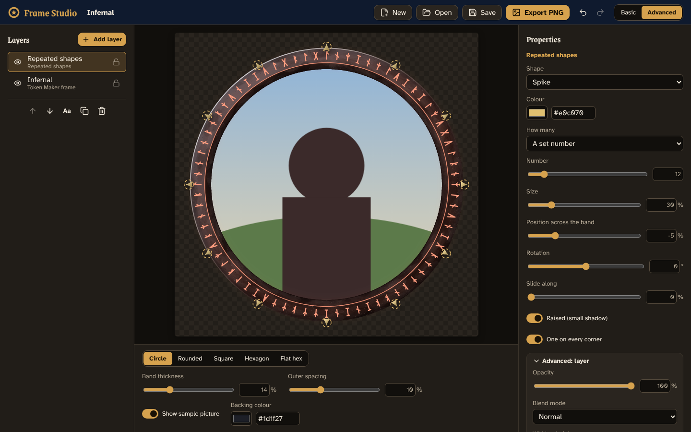

# Frame Studio

A visual editor for code-drawn token frames. Start from one of [Token Maker](https://github.com/GroudonMcL/token-maker)'s 27 frames or from scratch, build a design from layers (bands of colour, lines, rings of beads, runes, gems…), and save it or export it as a picture. No coding needed; technical settings live in **Advanced**.



## What works now (Phase 1)

- **Templates:** all 27 Token Maker frames (each as one layer whose colour you can change), two designs built from editable layers, or a blank project.
- **Layers:** Band fill, Line and Repeated shapes, plus Token Maker frames as layers. Show/hide, lock, rename, reorder, duplicate, delete.
- **Designs fit every token shape:** layers are placed relative to the frame band, so the same design works on a circle, square or hexagon, thick or thin.
- **Canvas:** click to pick a layer; drag to move it in or out, or round the token to slide repeated shapes along.
- **Undo/redo**, **autosave** (your work survives a refresh), **Save/Open** project files (`.framestudio.json`) and **Export PNG**.

See [`docs/PROGRESS.md`](docs/PROGRESS.md) for what's next and the known limitations.

## Running it on Windows

You need [Node.js](https://nodejs.org/) 22 or newer. In PowerShell:

```powershell
cd path\to\Frame-Studio
npm install          # once, or after pulling changes
npm run dev          # then open http://localhost:5173
```

Press `Ctrl+C` in PowerShell to stop it.

## Testing

```powershell
npm test             # unit and pixel tests
npm run typecheck    # TypeScript checks
npm run lint         # code style
npm run build        # production build into dist\
npx playwright install chromium   # once, before the first e2e run
npm run e2e          # end-to-end tests in a real browser
```

Handy for checking by eye:

```powershell
npm run frame-sheet -- sheet.png circle    # every template on one picture (try hexagon, square…)
npm run screenshots                        # with npm run dev running: editor screenshots into docs\screenshots
```

## Keeping the Token Maker engine in step

The frame-drawing code in `src\engine\legacy\` is copied from Token Maker and must not be edited here. With both repositories side by side:

```powershell
npm run engine:check -- ..\token-maker   # lists files that differ
npm run engine:sync -- ..\token-maker    # copies them and records the commit
npm test
```

## Documents

- [`docs/DESIGN.md`](docs/DESIGN.md): the design (source of truth).
- [`docs/TOKEN-MAKER-CONTEXT.md`](docs/TOKEN-MAKER-CONTEXT.md): how Token Maker's frames work, and an inventory of all 27.
- [`docs/BUILD-PROMPTS.md`](docs/BUILD-PROMPTS.md): the prompt for each build phase.
- [`docs/PROGRESS.md`](docs/PROGRESS.md): the phase checklist.
- [`docs/PROJECT-STARTER.md`](docs/PROJECT-STARTER.md): the original brief.
